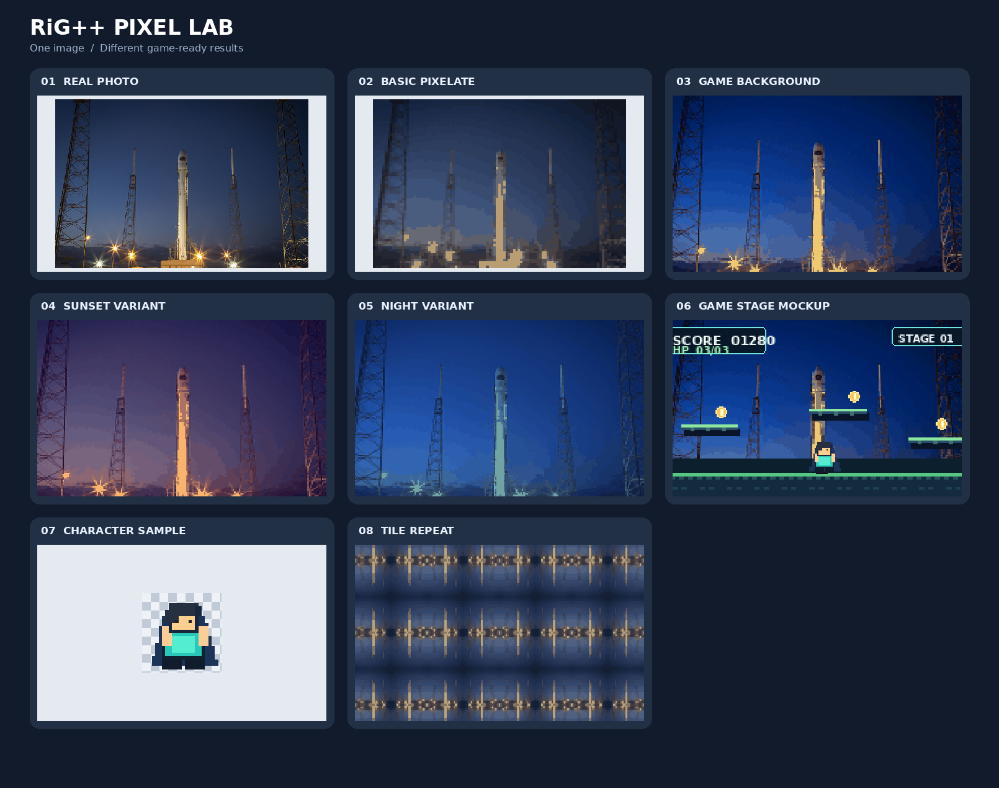

# RiG++ PixelLab v4 — 実写写真をゲーム用ドット絵に

**実写の写真を1枚選んで、通常のドット絵、ゲーム背景、夕暮れ・夜の雰囲気違い、ゲーム画面の使用イメージまで作れる** Windows用Pythonアプリです。RiG++ Advent Calendar 2026 の学習用サンプルです。



## 最も簡単な使い方（Windows）

1. ZIPを「すべて展開」する（ZIPの中から直接起動しない）。
2. `RiG_PixelLab_2026` フォルダの **`START_HERE_Windows.bat`** をダブルクリックする。
3. 初回だけ、専用 `.venv` を作成して Pillow とオプションのドラッグ＆ドロップ機能をインストールする。Python本体を入れ直す必要はありません。
4. 起動すると**実写のロケット写真**が自動で読み込まれます（イラストの入力サンプルはありません）。自分の写真にするには **「画像を選ぶ」** をクリック（ドラッグ＆ドロップも対応）。
5. スクロールして**元写真→通常ドット→鮮やかなゲーム背景→夕暮れ→夜→ゲーム配置例**を比べてください。
6. 気に入った設定で **「生成した画像を全部保存（PNG）」** を押します。

画面上部の設定欄も、下部の変換結果も**同じページで縦にスクロール**できます。個別のプレビュー画像をクリックすると拡大します。

## どこがゲーム向け？

前バージョンのような「暗くして16:9に切り抜くだけ」ではありません。

- **通常のドット絵**：縮小・色数制限・最近傍補間だけ。比較の基準。
- **ゲーム背景（鮮やか）**：ディテールを整える → コントラスト・彩度調整 → ピクセル単位の色調設計 → 色数制限 → 16:9で書き出し。
- **夕暮れ・夜のバリエーション**：同じ写真から異なる色調を作る。写真の形を維持します。
- **ゲーム画面見本**：生成した背景の上に、オリジナルのピクセルキャラクター、足場、コイン、スコアUIを組み合わせる（**静止画像で、ゲーム自体は動作しません**）。
- **追加素材**：付属のピクセルキャラクターと繰り返しタイル、単色背景からのスプライト切り抜き機能。

> 画像生成AIや機械学習による意味の理解・人物の完全自動切り抜きは行いません。自然写真の木・空・人物を意味的に分離する処理はありません。ゲーム背景として出力できる画像は960×540の静止PNGです。実際のゲームに組み込むには別途ゲームエンジン等で読み込んでください。

## 保存されるファイル

「全部保存」で、指定先に新しいフォルダを作成し、以下のファイルを保存します。

| ファイル名 | 用途 |
|---|---|
| `00_before_after_comparison.png` | 8つの比較結果を一覧で表示 |
| `01_normal_pixel_art.png` | シンプルなドット絵 |
| `02_game_background_960x540.png` | 色調補正済みの16:9ゲーム背景 |
| `03_game_background_sunset.png` | 夕暮れ版ゲーム背景 |
| `04_game_background_night.png` | 夜版ゲーム背景 |
| `05_game_stage_mockup.png` | 足場・キャラ・コイン・HUDを置いた静止画のデモ |
| `07_photo_sprite_only_for_plain_background.png` | 単色背景のときだけ役立つ被写体切り抜き（写真によっては四角いまま） |
| `08_builtin_pixel_hero.png` | オリジナルの透明背景キャラクタースプライト |
| `09_seamless_tile.png` | 64×64のシームレス用タイル |
| `10_repeating_tile_preview.png` | タイルを並べた見本 |
| `settings.json` | 今回の色数などを記録 |

**ゲームで実際に使うなら** `02_game_background_960x540.png` / `03_game_background_sunset.png` / `04_game_background_night.png` を背景として読み込み、 `08_builtin_pixel_hero.png` などを重ねる方法が分かりやすいです。

## 開発者向けの起動方法

Python 3.11以降を推奨（確認したWindows環境はPython 3.13.5）。

```powershell
python -m venv .venv
.\.venv\Scripts\python.exe -m pip install -r requirements.txt
.\.venv\Scripts\python.exe app.py
```

GUIのない環境では、`cli.py` も利用できます。プログラムの詳細は `pixel_engine.py` を参照してください。

テスト（画像処理中心）：

```powershell
.\.venv\Scripts\python.exe -m unittest discover -s tests -v
```

## 画像とソースコードの権利

- **プログラム**：MIT License（`LICENSE`）。
- **実写ロケット写真** `samples/sample_real_rocket.jpg`：SpaceXがパブリックドメインで公開したFalcon 9の打ち上げ写真。scikit-image `skimage.data.rocket()` から収録。 [出典・権利説明](https://scikit-image.org/docs/stable/api/skimage.data) 。
- **入力用サンプル**：実写ロケット写真1枚のみ。イラストの入力サンプルは同梱しません。ゲーム画面のデモ用キャラクターと足場は、プログラムが描画するオリジナルのピクセル素材です。
- **読者が読み込む写真**：写真ごとの利用権を確認してください。GitHubに自分の顔や私的な写真を意図せずアップロードしないようにしてください。

外部AI APIやオンラインアップロード機能はありません。画像変換はPC内で完結します。初回のみPythonパッケージのインストールにネット接続が必要です。

## よくある質問

**Q. 写真から完全なゲーム風景イラストになりますか？**

A. 色調・輪郭・ゲーム画面の要素を整える**非AIのスタイル変換**です。写真の構図は残ります。手描きのゲーム背景の品質や、内容に応じて建物を描き直すような処理を保証するものではありません。

**Q. 「ゲーム画面」から直接遊べますか？**

A. いいえ。素材の配置を示す**静止画のデモ**です。ゲームプログラムと組み合わせて使用してください。

**Q. スプライトの背景が消えません。**

A. 背景色がほぼ単色で、四隅が近い色の場合のみ自動透過します。背景が複雑な写真は先に背景除去が必要です。

**Q. Windowsでスクロールできません。**

A. 最新版は右のスクロールバーまたはマウスホイールで、**設定欄も含む画面全体を移動**できます。
